

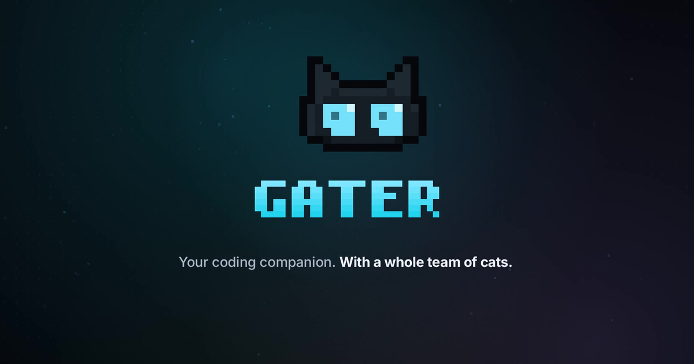

 

### Programa en serio. Nunca trabaja solo.

Un agente de programación local que lee tu proyecto, planifica, ejecuta y verifica. 
Cuando la tarea crece, llama a un equipo de gatitos especialistas.

 

**[Míralo en movimiento](#míralo-en-movimiento)** ·
**[En la terminal](#en-la-terminal)** ·
**[Conoce al equipo](#cuando-la-tarea-crece-llama-al-equipo)** ·
**[Pedir acceso a la beta](https://github.com/Gateton/Gater/issues/new?template=beta-access.yml)**

[English](README.md) · [Español](README.es.md)

> **Gater es de código cerrado, construido a la vista.** Este repositorio es su casa pública para información del producto, comentarios y solicitudes de beta. El código de la aplicación sigue siendo privado. Gater está en desarrollo activo; la primera versión estable aún se está preparando.

 

## Míralo en movimiento

Un recorrido de dos minutos por la terminal, la aplicación de escritorio, el equipo, los Rooms, Workshop, los checkpoints y los temas. Aquí está en 18 segundos, reproduciéndose en esta misma página:

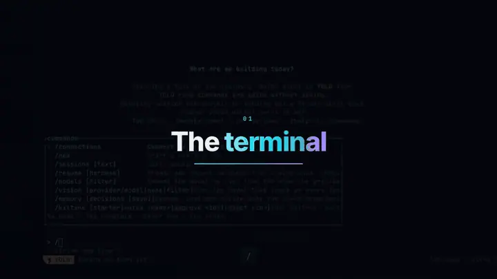

**[Descarga el recorrido completo de 2 minutos](assets/gater-promo.mp4?raw=true)** · MP4, 720p, 7,7 MB

<!--
  ¿Quieres un reproductor de vídeo integrado? GitHub solo reproduce vídeos subidos desde su propio editor.
  Edita este archivo en github.com, arrastra assets/gater-promo.mp4 al cuadro de texto, justo aquí,
  y conserva la línea https://github.com/user-attachments/assets/... que inserta GitHub.
-->

 

## Gater de un vistazo

| | | | |
| :---: | :---: | :---: | :---: |
| **2** interfaces, un mismo núcleo terminal y escritorio | **4** modos de trabajo Plan, Normal, YOLO, Turbo | **9** ayudantes por tarea 4 trabajando a la vez | **6** kittens incluidos y puedes crear más |
| **6** modos de Room para debatir antes de decidir | **2–3** intentos que compiten comparados con evidencia | **18** temas terminal, diffs y gato | **5** historiales de otros agentes importables sin tocar los originales |

 

## Qué puede hacer Gater

Pídele un cambio en lenguaje natural. Gater lee el código relevante, edita archivos, ejecuta comandos y comprueba el resultado. La actividad de las herramientas aparece mientras ocurre, los cambios tienen diffs que puedes inspeccionar, y `/undo` revierte los cambios de archivos del último turno, incluido el trabajo del equipo.

Gater vive en dos sitios: tu **terminal** y **Gater Desktop**. Los dos comparten el mismo núcleo en Rust, las sesiones, la configuración, la memoria y el equipo, así que lo que empiezas en uno lo puedes seguir en el otro.

### En la terminal

La TUI es donde nació Gater, y es una interfaz completa: razonamiento y llamadas a herramientas en vivo, un panel lateral con el plan, el equipo y los archivos que cambiaron, todo el callejón, los permisos, la memoria y los temas. No necesitas ninguna ventana.

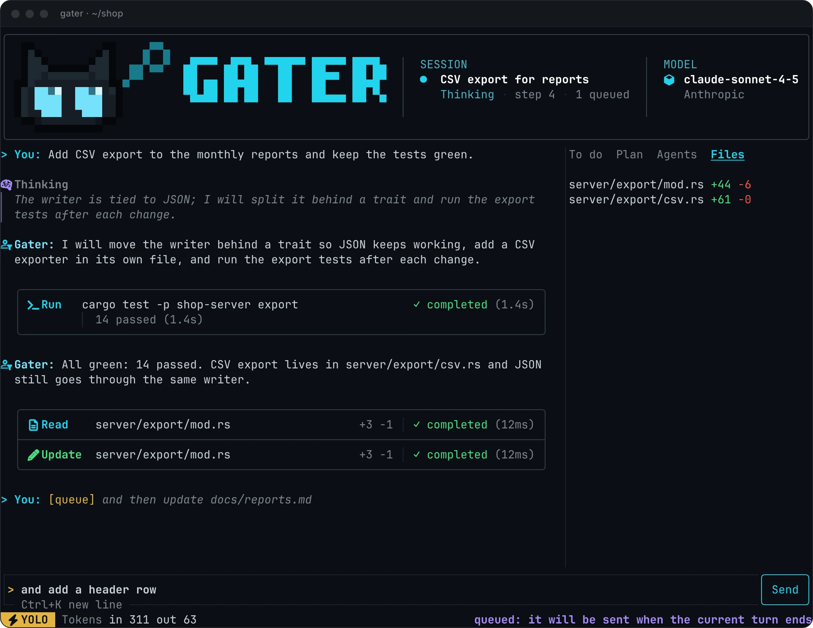

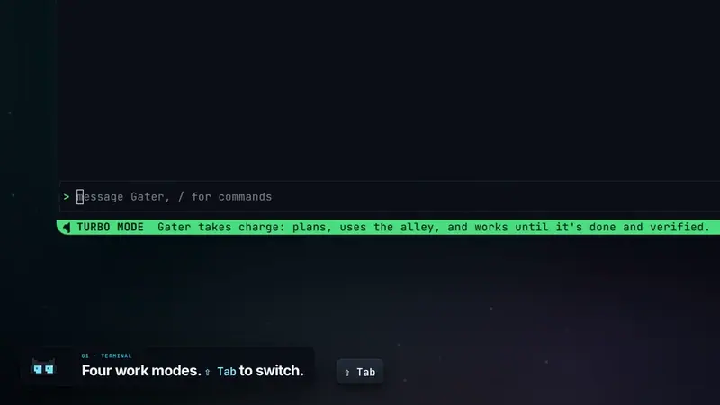

<table>
  <tr>
    <td width="50%" valign="top">
      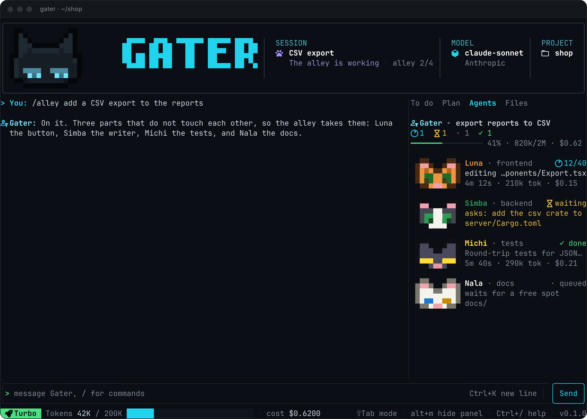 
      <b>El callejón, en el panel lateral</b> 
      Cuatro gatitos en paralelo, cada uno con su zona, su estado, sus tokens y su costo.
    </td>
    <td width="50%" valign="top">
      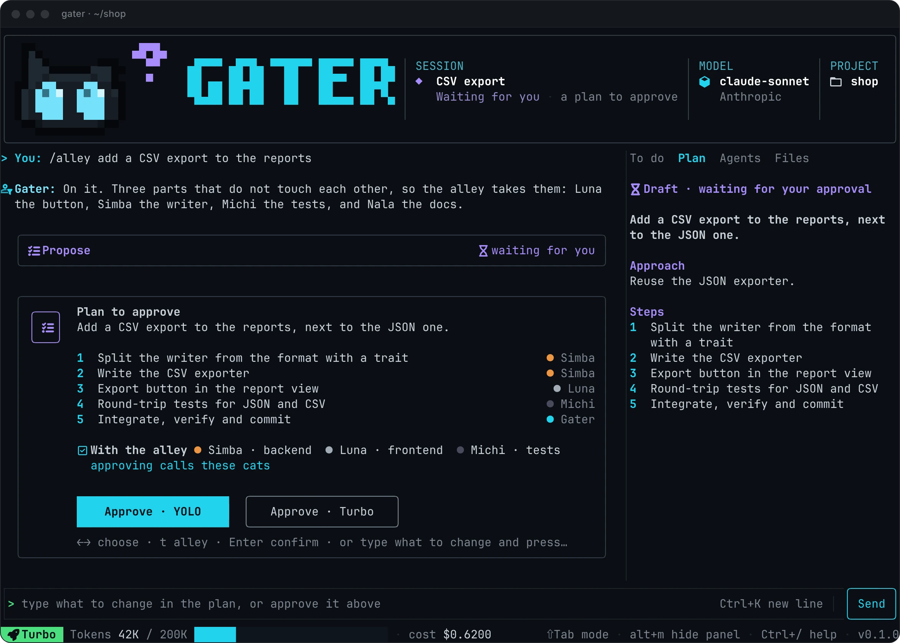 
      <b>Planes que tú apruebas</b> 
      Revisa los pasos, mira quién toma cada uno y elige YOLO o Turbo.
    </td>
  </tr>
  <tr>
    <td width="50%" valign="top">
      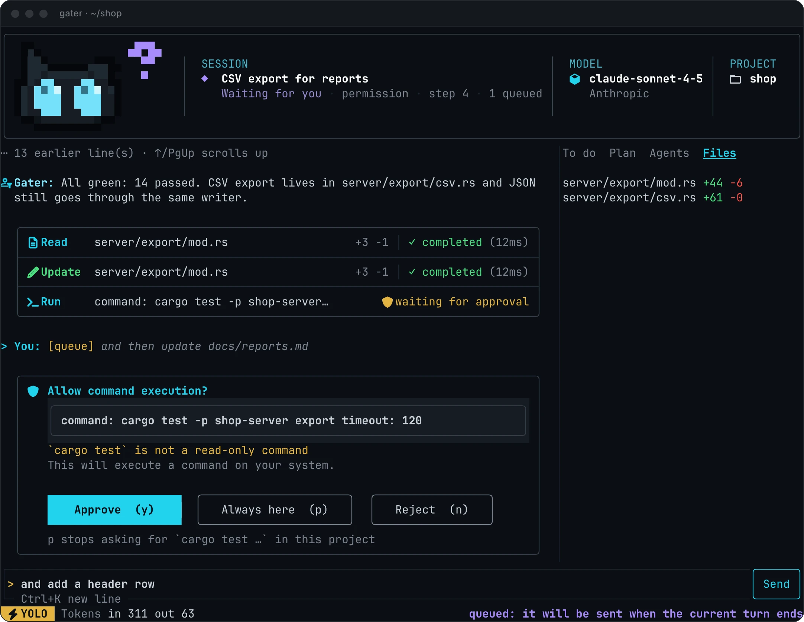 
      <b>Permisos que se entienden</b> 
      Aprueba una vez, recuerda un comando para el proyecto o di que no.
    </td>
    <td width="50%" valign="top">
      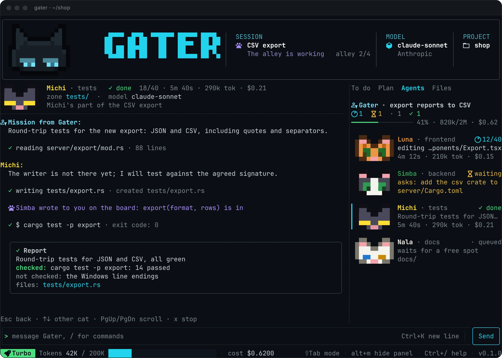 
      <b>Entra al cuarto de cualquier gato</b> 
      Lee exactamente qué hizo un gatito y escríbele mientras trabaja.
    </td>
  </tr>
</table>

<b>Más de la terminal</b>: tablero del equipo, temas, memoria e importación de sesiones

 

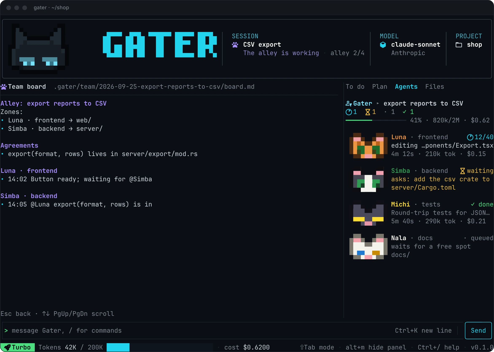

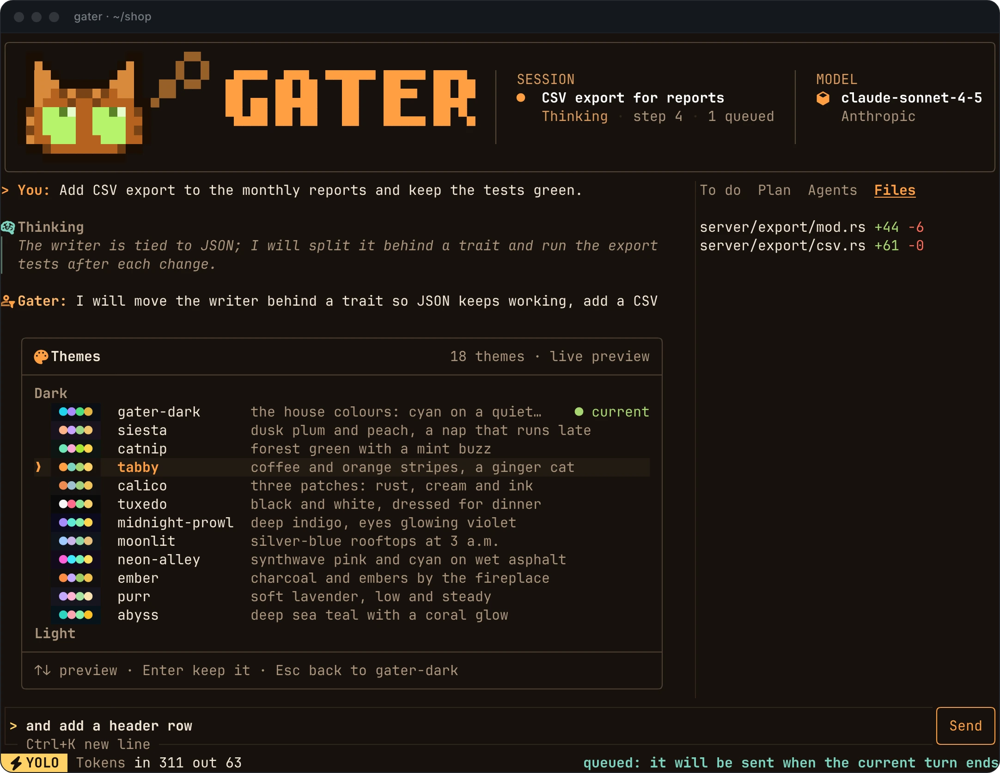

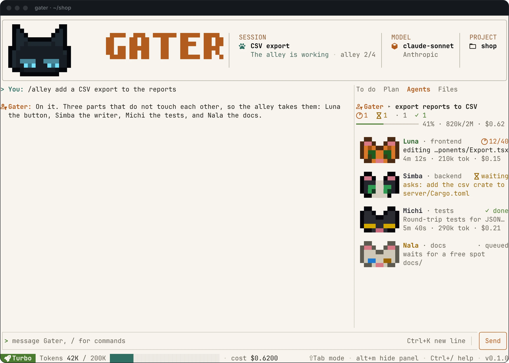

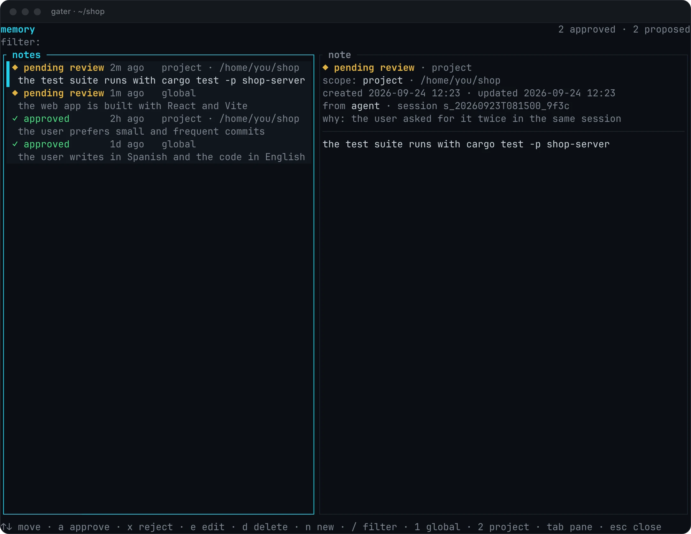

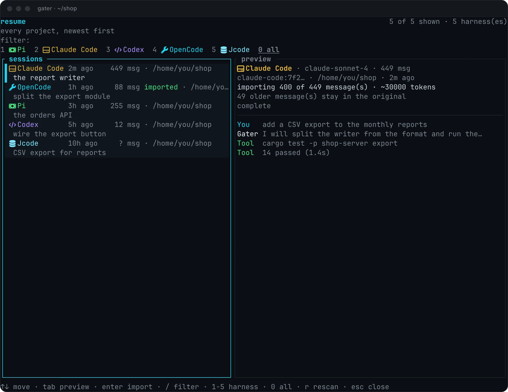

### En el escritorio

**Gater Desktop** pone al mismo agente en una ventana: un Kanban para el plan, el escenario del callejón, los Rooms, Workshop y los checkpoints como vistas visuales.

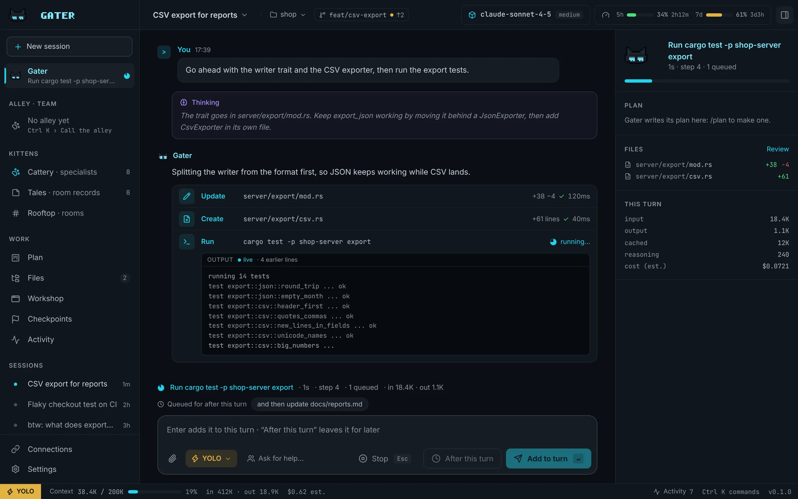

*Las imágenes de la terminal de este README están renderizadas directamente desde la TUI real de Gater, con datos de proyecto de ejemplo. Las de Desktop son escenarios de diseño capturados de la interfaz real de Gater, también con datos de ejemplo. Ninguna muestra una sesión de producción grabada.*

### Cómo avanza una tarea

1. **La describes.** En lenguaje natural, con capturas o archivos adjuntos si ayuda.
2. **Gater mira primero.** Lee y busca en tu proyecto, y propone un plan cuando la tarea lo merece.
3. **Trabaja a la vista.** Cada lectura, edición y comando aparece en vivo, y cada archivo cambiado tiene su diff.
4. **Verifica.** Corre tus pruebas y comprobaciones antes de dar el trabajo por terminado.
5. **Tú mandas.** Dirígelo mientras trabaja, deshaz el turno entero con `/undo` o restaura un checkpoint del proyecto.

### Tú decides cuánta libertad tiene

| Modo | Cómo funciona |
| --- | --- |
| **Plan** | Lee, pregunta y propone un plan antes de cambiar nada. Nada cambia hasta que lo apruebas. |
| **Normal** | Pide permiso antes de comandos que cambian cosas o escriben fuera del proyecto. |
| **YOLO** | Ejecuta con menos avisos de aprobación; borrar fuera del proyecto sigue preguntando. |
| **Turbo** | Se encarga de planificar, coordinar al equipo y seguir verificando hasta terminar. |

Cambia de modo con `Shift+Tab`. Mantén un plan persistente, sigue el avance en el **Kanban** de Desktop y dirige la tarea mientras corre: `Enter` suma una instrucción nueva al turno en curso y `Shift+Enter` la deja en cola.

 

## Cuando la tarea crece, llama al equipo

### Alley · Un equipo armado para cada tarea

Gater reparte el trabajo independiente entre gatitos, le da a cada uno una misión, una zona de escritura y un presupuesto, y luego integra y verifica sus resultados. Revisa su actividad y sus conversaciones, o escríbele a un gatito mientras trabaja.

**Hasta 9 ayudantes por tarea, 4 activos a la vez.** Son límites de capacidad, no tamaños de equipo por defecto.

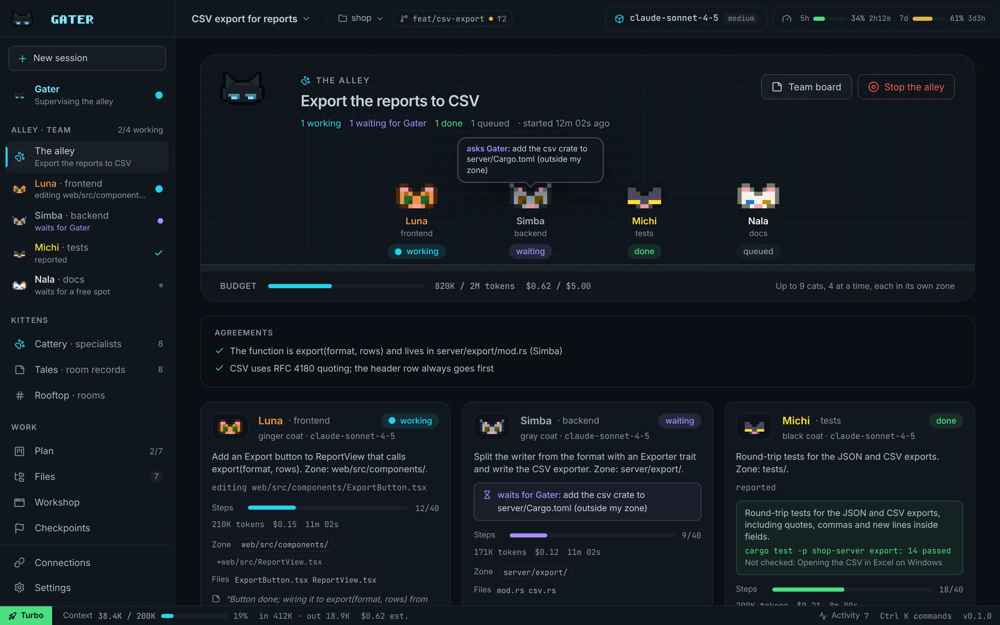

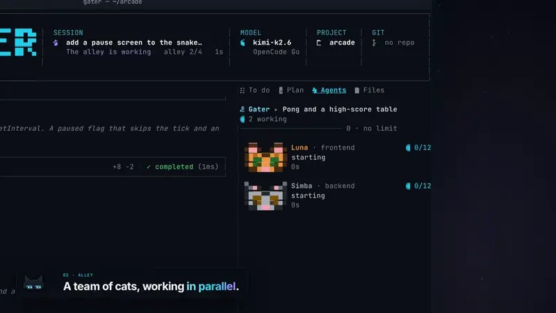

### Cattery · Tus especialistas, con memoria

Crea kittens persistentes con su propia personalidad, modelo, skills y permisos. Sus recuerdos aprobados y sus historiales de trabajo se mantienen entre tareas. Guarda un grupo como **clowder** y vuelve a llamarlo cuando lo necesites.

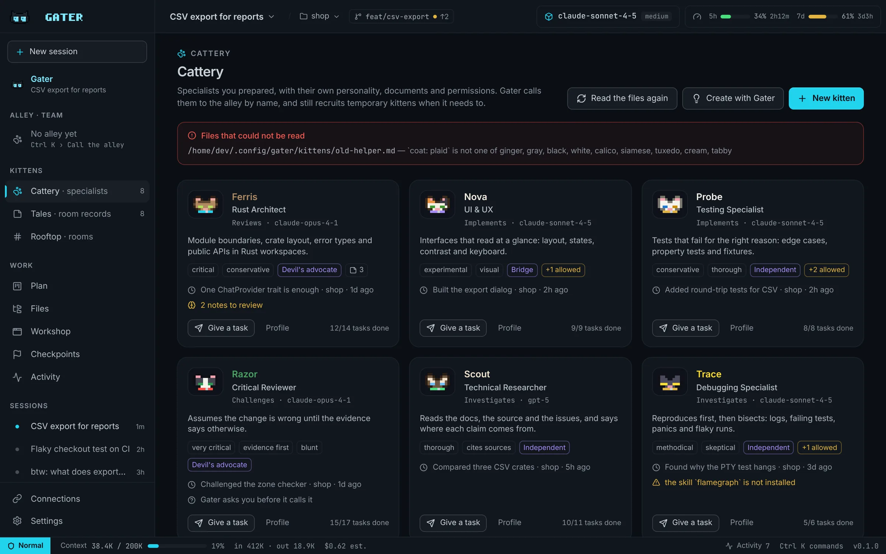

| Kitten de inicio | Especialidad | Qué hace |
| --- | --- | --- |
| **Scout** | Investigación | Responde leyendo código, docs y la web, con una fuente por cada afirmación. |
| **Razor** | Revisión de código | Busca bugs reales y casos que faltan, y verifica cada hallazgo. |
| **Trace** | Depuración | Reproduce, plantea hipótesis, aísla, arregla la causa y deja una prueba de regresión. |
| **Probe** | Pruebas | Escribe y corre pruebas que fallan por la razón correcta. |
| **Pixel** | Interfaz | Revisa interfaces en marcha: estados, contraste, ventanas estrechas, teclado. |
| **Hiss** | Cuestionar supuestos | Busca el supuesto más débil, el caso olvidado y la alternativa más barata. |

### Rooms · Debatir antes de decidir

Los especialistas proponen por separado, se critican con evidencia y revisan sus posiciones. Un Room registra su desenlace, con las objeciones o dudas que queden, para que puedas seguir la conversación con Gater.

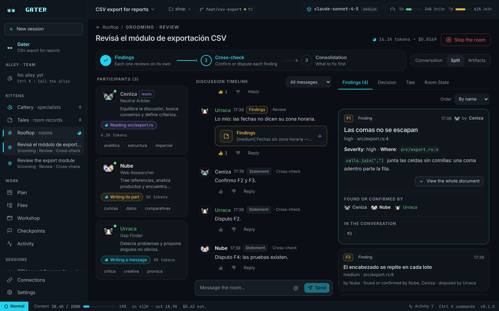

| Modo de Room | Úsalo para |
| --- | --- |
| **Caterwaul** · Discusión | Reunir propuestas a ciegas, criticar citando y revisar hasta una posición final. |
| **Prowl** · Investigación | Dividir una pregunta, investigar cada parte con fuentes y consolidar. |
| **Grooming** · Revisión | Revisar desde varios ángulos a ciegas y luego verificar los hallazgos entre todos. |
| **Scratch** · Desafío | Atacar un diseño o un código con evidencia, corriendo comandos en una copia. |
| **Landing** · Recuperación | Ir de la evidencia a la causa y a una propuesta de arreglo cuando algo se rompió. |
| **Nine Lives** · Exploración | Desarrollar una alternativa distinta por kitten, comparar y recomendar. |

Los modos de Room son archivos de texto, así que puedes personalizarlos o escribir los tuyos.

### Intentos · Compara soluciones antes de aplicar una

Prueba implementaciones distintas en copias separadas del proyecto. Compara archivos cambiados, resultados de verificación, dependencias nuevas y decisiones afectadas, y elige qué intento aplicar.

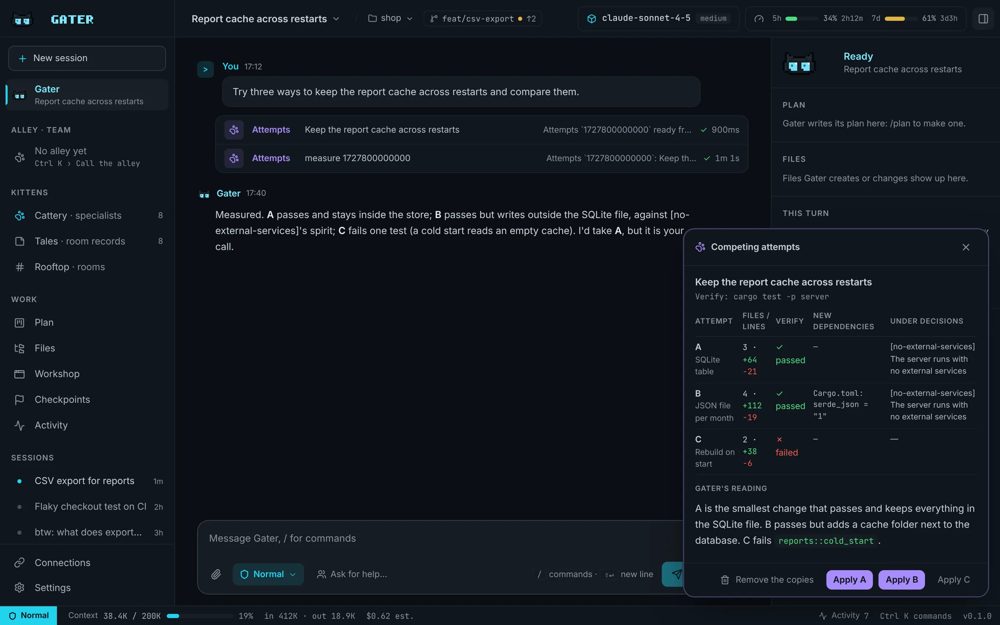

 

## Señala tu interfaz. Gater la cambia.

**Workshop** trae un frontend en marcha dentro de Gater Desktop.

1. **Run project:** Gater averigua cómo arranca tu app y te pide permiso para ejecutarla.
2. **Select:** haz clic en el elemento que quieres cambiar.
3. **Ask:** describe el cambio; Gater localiza el código relevante y lo edita.
4. **Check:** revisa la vista actualizada y deshaz el cambio si hace falta.

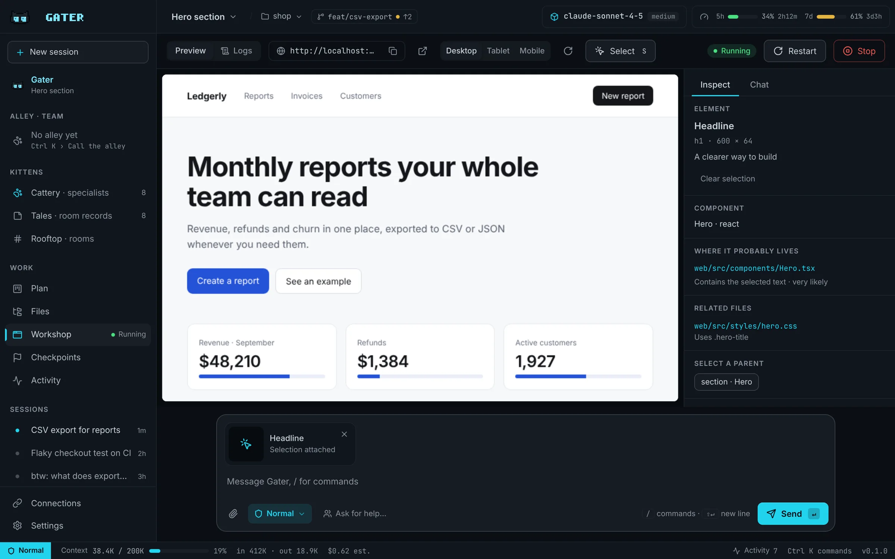

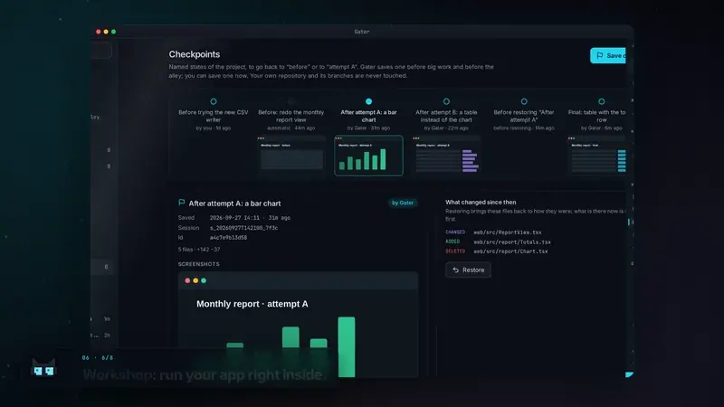

 

## Un gato que te dice qué está haciendo

El gato de píxeles reacciona al estado del agente, en la terminal y en el escritorio. Las animaciones se pueden apagar con `/animations off`.

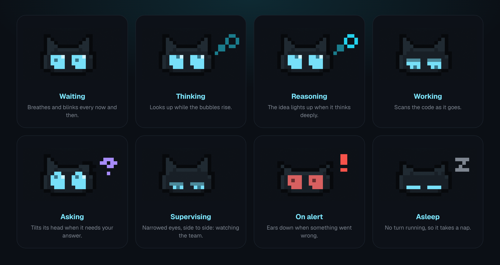

 

## Tú tienes el control

| Capacidad | Qué te da |
| --- | --- |
| **Memoria y decisiones aprobadas** | Gater propone qué recordar y qué decisiones guardar, con sus motivos y los archivos relevantes. Nada se guarda sin tu visto bueno, y te avisa cuando un cambio contradice una decisión. |
| **Checkpoints de todo el proyecto** | Restaura instantáneas guardadas en un repositorio sombra, fuera del tuyo. Se hacen solas antes de los cambios grandes. |
| **`/undo`** | Revierte los cambios de archivos del último turno, incluido lo que hizo el equipo. |
| **Permisos que se entienden** | Aprueba una llamada una vez, o recuerda un patrón de comando para el proyecto y revócalo luego desde la configuración. |
| **Diario del proyecto** | Un registro continuo de dónde está el proyecto, qué sigue y qué está roto. |

Memoria y checkpoints en la interfaz de Desktop

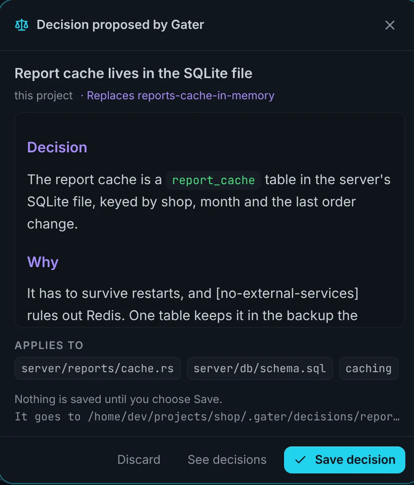

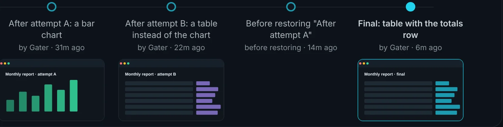

 

## Lo que viene de serie

| Capacidad | Qué te da |
| --- | --- |
| **Tus modelos** | Anthropic, OpenAI y proveedores compatibles como DeepSeek, OpenRouter y OpenCode Go. Con clave de API o con autenticación por suscripción donde se admite. |
| **Visibilidad del uso** | Modelo, contexto y la información de uso disponible, distinguiendo las estimaciones de lo que informa el proveedor. |
| **Web y navegador** | Busca documentación, lee páginas como Markdown y usa automatización de navegador para inspeccionar una app. |
| **Skills y hooks** | Flujos reutilizables en formato `SKILL.md` (revisión, revisión de seguridad, depuración, escribir pruebas, commit y PR, revisión de interfaz y más), además de hooks que corren alrededor de las herramientas y los turnos. |
| **MCP** | Añade herramientas de servidores MCP en los que confías explícitamente, recortadas por servidor y por kitten. |
| **Trae tus sesiones** | Importa historiales de Claude Code, Codex, OpenCode, jcode y pi sin modificar los originales. |
| **Bifurca una conversación** | `/btw` hace una pregunta aparte sin perder el hilo principal. |
| **Imágenes y archivos** | Adjunta referencias y capturas; la visión depende del modelo elegido o del proveedor de visión configurado. |
| **Contexto a la vista** | Un medidor de contexto en vivo y `/compact` para condensar una sesión larga. |
| **18 temas** | Personaliza la terminal, los diffs y el gato de píxeles, con vista previa en vivo. Oscuros y claros, del cian tranquilo de `gater-dark` a `tabby`, `neon-alley` y `porcelain`. |
| **Accesibilidad** | Pensado para teclado, compatible con lectores de pantalla y con movimiento reducido, y con el contraste comprobado en los 18 temas de Desktop. |

Referencia rápida de comandos

| Área | Comandos |
| --- | --- |
| **Trabajo** | `/plan` `/mode` `/yolo` `/turbo` `/undo` `/cancel` `/compact` `/bash` `/cd` |
| **Equipo** | `/alley` `/kittens` `/rooms` |
| **Contexto** | `/memory` `/checkpoints` `/journal` `/skills` `/mcp` |
| **Sesiones** | `/sessions` `/new` `/rename` `/delete` `/resume` `/btw` `/debug` |
| **Modelos** | `/login` `/logout` `/models` `/thinking` `/usage` `/vision` `/connections` |
| **Aspecto** | `/themes` `/animations` `/panel` |
| **Otros** | `/config` `/help` `/quit` |

Desde la línea de comandos: `gater` abre la TUI, `gater desktop` abre la aplicación y `gater run "…"` ejecuta un turno sin interfaz, útil en scripts.

 

## Acceso a la beta

Gater es **Linux primero**, con soporte para Windows. La disponibilidad y las instrucciones de instalación se compartirán con los testers aceptados; todavía no hay una versión pública estable.

**[Pide acceso a la beta](https://github.com/Gateton/Gater/issues/new?template=beta-access.yml)** y cuéntanos:

- Tu sistema operativo.
- Las herramientas de programación y los proveedores de modelos que usas.
- Una tarea real que te gustaría probar con Gater.

Las solicitudes son públicas. No incluyas claves de API, archivos privados de proyectos ni datos de contacto personales. Pedir acceso no garantiza una invitación.

Dale una estrella o sigue este repositorio para enterarte de las novedades. Las versiones públicas, cuando existan, aparecerán en [Releases](https://github.com/Gateton/Gater/releases).

 

## Comentarios y rumbo

[Reportar un bug](https://github.com/Gateton/Gater/issues/new?template=bug-report.yml) · [Proponer una mejora](https://github.com/Gateton/Gater/issues/new?template=feature-request.yml)

Prioridades actuales:

- Mejorar la fiabilidad en sesiones largas y en la coordinación del equipo.
- Pulir las vistas previas de Workshop y la edición visual.
- Validar el comportamiento de los proveedores, el reporte de uso y la importación de sesiones.
- Afinar la distribución en Linux y Windows para la primera versión estable.

Estas prioridades son una dirección, no fechas de entrega.

 

## Preguntas frecuentes

<strong>¿Gater es de código abierto?</strong>

No. Gater es un producto propietario. Este repositorio público contiene materiales de presentación y comentarios de la comunidad, no el código de la aplicación. No se concede ninguna licencia de código abierto sobre la aplicación.

<strong>¿Mi código sale de mi máquina?</strong>

Gater corre en local y guarda en tu equipo las sesiones, la memoria, las decisiones y las credenciales. Los prompts y el contenido del proyecto que hacen falta se envían al proveedor de modelos que elijas para realizar la tarea. Las herramientas de web, navegador y MCP se comunican con los servicios que configures.

<strong>¿Necesito un proveedor de modelos?</strong>

Sí. Trae una clave de API compatible o usa autenticación por suscripción donde el proveedor lo permita. El uso de los modelos está sujeto a los términos y límites de ese proveedor.

<strong>¿Puedo deshacer lo que hace?</strong>

Sí. `/undo` revierte los cambios de archivos del último turno, incluido el trabajo del equipo, y los checkpoints del proyecto te permiten volver a momentos anteriores sin tocar tu propio repositorio. En modo Normal, los comandos que cambian cosas piden permiso antes.

<strong>¿Puedo usarlo solo desde la terminal?</strong>

Sí. La TUI y Gater Desktop comparten el mismo núcleo, así que puedes usar cualquiera de las dos o pasar de una a otra a mitad de proyecto. Workshop, el plan en Kanban y las vistas visuales del equipo son funciones de Desktop.

<strong>¿Puedo instalarlo ya?</strong>

Pide acceso a la beta. Las versiones y los pasos de instalación compatibles se entregan a medida que estén disponibles.

 

## Más del creador

Creado por **[Thomas “Gateton” Repka](https://github.com/Gateton)**.

- [pi-usage-live](https://github.com/Gateton/pi-usage-live): visibilidad del uso de proveedores para Pi.
- [session-hub](https://github.com/Gateton/session-hub): herramientas para descubrir y llevar sesiones de agentes de programación entre herramientas.

---

Tu compañero de programación. Con un equipo entero de gatos.

